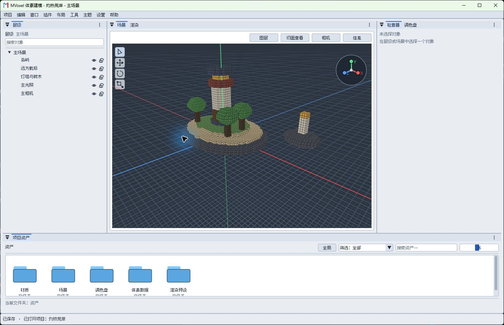
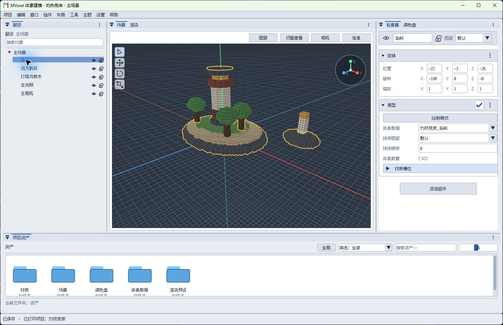

# 快速入门

跟着下面四步，完成第一次建模。点击图片可在小窗口中预览，默认适应窗口；需要看清控件文字时再选择“原尺寸 100%”。教程和图片预览可拖动位置，不参与面板停靠。

## 1. 创建项目

在欢迎界面选择“新建项目”，填写名称和位置，选择模板。已有项目可选择“打开项目”。

## 2. 选择模型和颜色

在左侧层级中选择体素模型，在模型组件中选择“绘制模式”，然后在调色盘选择颜色。空场景可通过“项目 > 新建体素模型”开始。

## 3. 开始绘制

在场景中按住左键拖动，松开放置；按住 Shift 拖动擦除。按 Ctrl+Z 撤销。视角操作见左侧“视角与绘制”。

## 4. 保存和预览

按 Ctrl+S 保存项目；切换到“渲染”查看相机画面，并可导出图片。场景名称旁的 * 表示有未保存修改。

> 自动保存的恢复快照不等同于正式保存，恢复后请检查并保存项目。

其他操作可从左侧选择章节，控件悬停提示也提供细节。

## 继续阅读

[继续学习：视角与绘制](视角与绘制.md#画出体素)
[查看保存与导出](资产与渲染.md#预览和导出图片)
