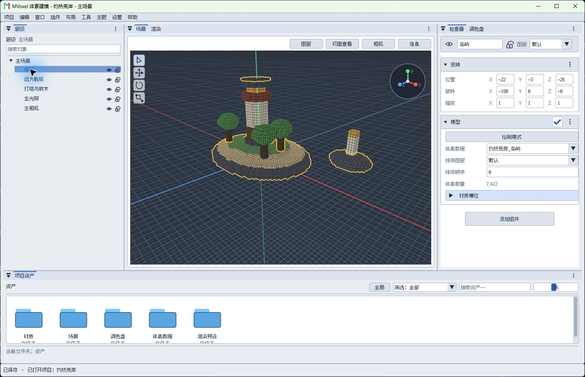

# 视角与绘制
## 移动视角
右键拖动环绕，中键拖动平移，滚轮缩放。双击层级中的对象可以聚焦。
开启大写锁定后，可用 WASD 移动、Q/E 升降，按住 Shift 加速。

## 画出体素
1. 在层级选择模型，开启模型组件的“绘制模式”，在调色盘选颜色。
2. 在场景中左键拖动，松开放置；按住 Shift 拖动擦除。拖动时按右键取消。
3. 再次点击绘制模式退出。更换对象时先在层级中选择目标。
> 画笔颜色和材质只影响新画的体素。Ctrl+Z 可以撤销。

## 继续阅读

[查看撤销与重做](撤销与重做.md#撤回一步)
